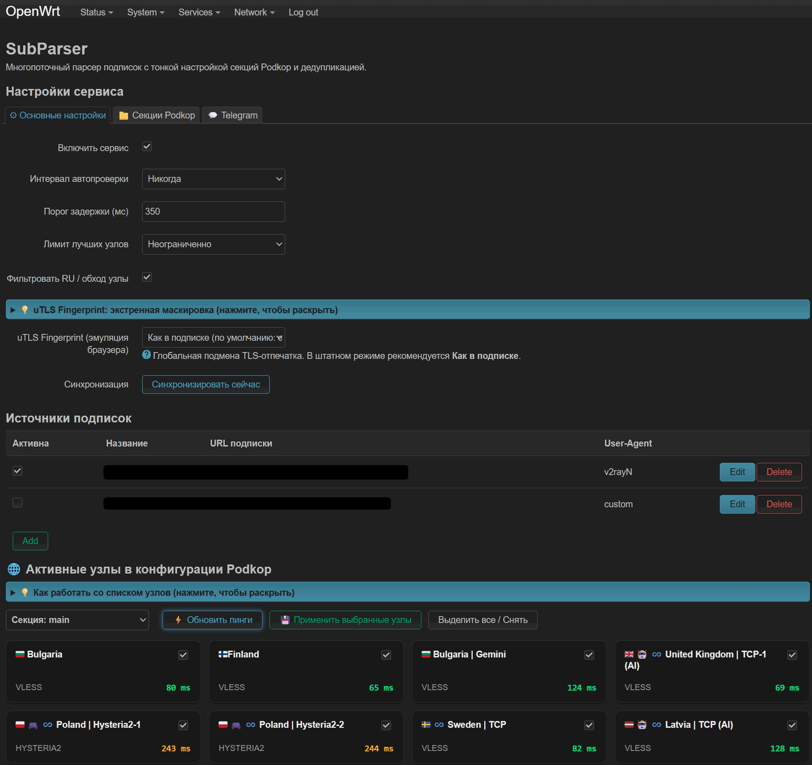
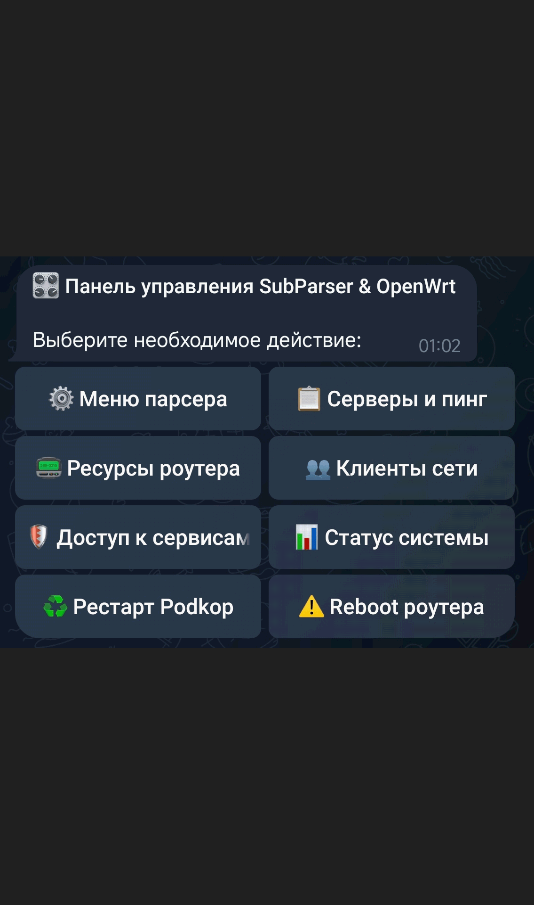

# ⚡ SubParser for OpenWrt

<p align="center">
  
  
  
  
  
  
  
</p>

> [!CAUTION]
> ### ⚠ Дисклеймер
> 
> 
> Этот проект делался для личных нужд и тестировался на ограниченном количестве роутеров под управлением OpenWrt 24.10.8 и 25.12.5. Совместимость с другими версиями носит исключительно гипотетический характер.  
> Архитектура местами представляет собой классическое «работает — не трогай».  
> Если вы каким-то чудом наткнулись на этот репозиторий и у вас что-то не заводится, отваливается или не работает так, как задумано автором — простите, извините, спасибо, пожалуйста.  
> Никаких гарантий стабильности нет, используйте исключительно на свой страх и риск.  
> О проблемах можете писать в чате TG канала, возможно попробуем пофиксить.

---

## 🧪 Протестированные конфигурации

Работоспособность гарантированно проверялась автором только на следующих связках компонентов. Поведение на других версиях не исследовалось.

| Компонент | Проверенные версии / Сборки |
| :--- | :--- |
| **Устройство** | Xiaomi Mi Router AX3000T |
| **Версия OpenWrt** | `24.10.8` (r29233-443ec4032a), `25.12.5` (r33051-f5dae5ece4) |
| **Podkop & LuCI App** | `v0.7.22` |
| **sing-box (extended)** | `1.14.0-extended-2.7.0`, `1.14.1-extended-2.7.1`, `1.14.1-extended-2.7.2` |

> 💬 **Делитесь отчетами о тестах!**  
> Если вы протестировали работу SubParser на другом роутере, архитектуре или версии OpenWrt — напишите об этом в специальной ветке **«Репорты работоспособности»** [Telegram-чата](https://t.me/SubParserChat). Это поможет составить общую базу совместимости.

---

## ⚡ Быстрый старт

### 📥 Установка

Подключитесь к роутеру по SSH и выполните команду чистой установки:

```sh
sh -c "$(curl -sL https://raw.githubusercontent.com/ib0lit/SubParser/main/install.sh)"

```

> После установки откройте веб-интерфейс: **LuCI → «Службы» → «SubParser»** для настройки.

### 🔄 Обновление

Обновление до актуальной версии без потери подписок, настроек и токенов:

```sh
sh -c "$(curl -sL https://raw.githubusercontent.com/ib0lit/SubParser/main/update.sh)"

```

### 📦 Установка и обновление с ветки `old`

Ветка `old` — архив предыдущей реализации парсера **v2.1.9**
(VLESS/Trojan/Hysteria2, без Shadowsocks и SOCKS). Скрипты в ней по умолчанию работают
с самой веткой `old`:

```sh
# установка версии из ветки old
sh -c "$(curl -sL https://raw.githubusercontent.com/ib0lit/SubParser/old/install.sh)"

# обновление в пределах ветки old
sh -c "$(curl -sL https://raw.githubusercontent.com/ib0lit/SubParser/old/update.sh)"
```

Вернуться на актуальную версию:

```sh
SUBPARSER_BRANCH=main sh -c "$(curl -sL https://raw.githubusercontent.com/ib0lit/SubParser/main/update.sh)"
```

Выбранная ветка сохраняется в `/etc/subparser_branch`, а в LuCI её можно указать в поле
**«Ветка GitHub для обновлений»**. Настройки, подписки и токен бота при обновлении
не перезаписываются.

### 🗑 Удаление

Полное удаление пакета, фоновых служб, записей crontab и кэша веб-интерфейса:

```sh
sh -c "$(curl -sL https://raw.githubusercontent.com/ib0lit/SubParser/main/uninstall.sh)"

```

---

## 📦 Готовые пакеты и портативный архив

В релизах проекта публикуются три варианта установки. У пакета своя версия
(`1.0.0`), а версия ядра парсера остаётся отдельной (`2.1.9`): пакет можно
пересобирать и обновлять, не меняя версию ядра.

| OpenWrt | Формат | Файл |
| :--- | :--- | :--- |
| 19.07 – 24.10 | `opkg` / IPK | `luci-app-subparser_1.0.0-1_all.ipk` |
| 25.12+ | `apk` v3 | `luci-app-subparser-1.0.0-r1.apk` |
| Любая версия | tar.gz + `install.sh` | `subparser-1.0.0.tar.gz` |

### IPK (OpenWrt 19.07 – 24.10)

```sh
wget -O /tmp/luci-app-subparser.ipk \
  https://github.com/ib0lit/SubParser/releases/download/v1.0.0/luci-app-subparser_1.0.0-1_all.ipk
opkg install /tmp/luci-app-subparser.ipk
```

### APK (OpenWrt 25.12+)

```sh
wget -O /tmp/luci-app-subparser.apk \
  https://github.com/ib0lit/SubParser/releases/download/v1.0.0/luci-app-subparser-1.0.0-r1.apk
apk add --allow-untrusted /tmp/luci-app-subparser.apk
```

Пакеты пока не подписаны, поэтому для APK нужен `--allow-untrusted`.

### Портативный архив (любая версия OpenWrt)

Если пакетный менеджер недоступен или не хочется ставить пакет, можно
распаковать архив прямо в `/tmp` и запустить локальный установщик:

```sh
cd /tmp
wget -O subparser-1.0.0.tar.gz \
  https://github.com/ib0lit/SubParser/releases/download/v1.0.0/subparser-1.0.0.tar.gz
tar -xzf subparser-1.0.0.tar.gz
cd subparser-1.0.0
sh install.sh --local
```

Скрипт разложит файлы из `root/`, сохранит существующий
`/etc/config/subparser` и настроит службы так же, как обычная установка.
Для удаления используйте `uninstall.sh` из архива.

### Что даёт пакетная установка

* Автоматическая проверка и установка зависимостей (`python3`, `curl`, `ca-bundle`, `conntrack`, `luci-base`);
* учёт установленных файлов: `opkg remove` / `apk del` удаляют пакет без ручной чистки;
* `/etc/config/subparser` помечен как conffile и не перезаписывается при обновлении;
* `postinst`/`postrm` включают, перезапускают и останавливают службы, обновляют cron и кэш LuCI;
* одинаковые артефакты и `SHA256SUMS` для каждого релиза — удобно проверять целостность и ставить на несколько роутеров.

Важно: пакет **не обновляет себя сам** из git. Если вы ставили пакет,
обновляйтесь через `opkg upgrade` / `apk upgrade` (или новым файлом из релиза).
Если вы ставили скриптом/архивом — используйте `update.sh`. Смешивать эти
способы не рекомендуется.

### Сборка релиза локально

```sh
sh build-release.sh
```

Скрипт создаст в `dist/` IPK, APK, `subparser-1.0.0.tar.gz` и `SHA256SUMS`.
Для APK нужен `apk-tools` 3; если его нет, `build_apk.sh` автоматически
использует Docker-образ `alpine:edge`. Публикация релиза происходит
в GitHub Actions при пуше тега `v*`.

---

## 🌿 Ветки и релизы

- **`main`** — стабильная ветка. Сюда попадает только проверенный код. Пуш тега `v*` в `main` запускает сборку и публикацию GitHub Release.
- **`beta`** — ветка для исправлений и новых функций. Каждый пуш в неё собирает IPK/APK/архив как artifacts GitHub Actions, но релиз не публикует. Номер релиза пакета берётся из номера запуска Actions, поэтому тестовые сборки можно ставить поверх предыдущих.
- **`fix/...`, `feat/...`** — временные ветки от `beta`; вливаются в `beta` через pull request.

Порядок работы:

1. Исправление или фича делается в отдельной ветке от `beta`.
2. После проверки — merge в `beta`, CI собирает тестовые пакеты.
3. Проверенная версия вливается из `beta` в `main`.
4. Перед релизом версия пакета поднимается в `root/etc/subparser_pkg_version`.
5. На `main` ставится тег `vX.Y.Z` и пушится — запускается публикация релиза.

Прямые коммиты в `main` лучше запретить через branch protection в настройках GitHub.
Тестовые beta-пакеты имеют версию вида `1.0.0-r<номер_запуска>`; после них переход
на стабильную `1.0.0` может потребовать переустановки, поэтому для стабильного
обновления используйте следующий релиз с более высокой версией.

---

## 🪶 Slim-сборка sing-box для роутеров с малым объёмом флеш-памяти

`sing-box-extended` из фида занимает **~95 МБ** и на устройствах с флеш-памятью 128 МБ и меньше
забивает `/overlay` под 100 % — после этого перестают сохраняться настройки и обновления.

Готовые сборки **~44 МБ** (архив ~15 МБ) опубликованы в
**[GitHub Releases](https://github.com/ib0lit/SubParser/releases/tag/slim-v1.14.3-extended-2.7.3)**
под все распространённые архитектуры OpenWrt: `amd64`, `386`, `arm64`, `armv7`, `armv6`,
`armv5`, `mips`, `mipsle`, `mips64`, `mips64le`, `riscv64`.
В каталоге [`slim/`](slim/) — установщик, контрольные суммы и документация.

Сохранены все функции, нужные Podkop и SubParser: **XHTTP, VLESS encryption, Reality/uTLS,
Fallback, Failover, DNS fallback, Hysteria2, Clash API, TPROXY**. Вырезаны TUN/gVisor,
admin panel, Node Manager и неиспользуемые протоколы.

Установка одной командой (архитектура определяется автоматически):

```sh
sh -c "$(curl -fsSL https://raw.githubusercontent.com/ib0lit/SubParser/slim-v1.14.3-extended-2.7.3/slim/install-slim.sh)"
```

Скрипт сверит SHA256, проверит конфиг **до** замены, заменит `/usr/bin/sing-box`,
перезапустит Podkop и покажет статус. Поддерживается откат: `install-slim.sh --rollback FILE`.

📘 Подробно: **[slim/README.md](slim/README.md)** — таблица архитектур, установка через
WinSCP, откат, поведение после `apk upgrade`, сборка из исходников.

---

## 📖 О проекте

**SubParser** — легковесный инструмент автоматизации для OpenWrt:

* Автоматический парсинг подписок по ссылке (VLESS Reality/TLS, Trojan, Hysteria2, Shadowsocks, SOCKS4/4a/5);
* Проверка доступности, удаление дубликатов и отсеивание самых стабильных серверов с последующей автоматической выгрузкой в секции Podkop;
* Фильтр протоколов: выбранные протоколы исключаются сразу после загрузки подписки — до дедупликации и первого этапа скрининга;
* Гибкая настройка через веб-интерфейс LuCI и удаленное управление через Telegram-бот.

---

## 📸 Скриншоты интерфейса

<details>
<summary><b>🌐 Демонстрация панели управления LuCI</b></summary>
<br>

*Интерактивная панель параметров, гибкая настройка подписок и дашборд узлов Podkop с замером пинга:*

<p align="center">
  
</p>
</details>

<details>
<summary><b>🤖 Демонстрация Telegram-бота</b></summary>
<br>

*Удаленный мониторинг роутера, управление узлами, подписками и сетевыми клиентами прямо в мессенджере:*

<p align="center">
  
</p>
</details>

---

## ✨ Ключевые возможности

### 🚀 Отбор и стресс-тестирование узлов

* **Параллельная проверка (до 12 потоков)**: экспресс-тестирование пула из сотен серверов за секунды.
* **Двухэтапная фильтрация**:
  - *Быстрый скрининг*: первичная проверка доступности серверов подписок через HTTP 204.
  - *Тест стабильности (Jitter Analysis)*: серия из 5 контрольных замеров для отсева серверов с потерями пакетов и нестабильной задержкой.

* **Поддерживаемые протоколы**: VLESS (Reality, TLS, WebSocket, gRPC, XHTTP), Trojan, Hysteria2, Shadowsocks (SIP002 и legacy-формат), SOCKS4/4a/5.
* **Интеллектуальный фильтр RU**: автоматическое отсеивание серверов для обхода белых списков (отключается в настройках).
* **Лимитирование пула (Top-N)**: Возможность ограничить выгрузку в Podkop только Топ-3/5/10 самых стабильных серверов или выгрузка полного пула, прошедшего проверку.
* **Защита от потери связи (Smart Fallback)**: если ни один сервер не уложился в заданный в настройках пинг, выбираются наименее медленные серверы; если пул проверенных серверов полностью недоступен (менее 2 рабочих), конфигурация Podkop остаётся нетронутой с алертом администратору в боте.
* **Контроль трафика и лимитов**: парсинг заголовков `Subscription-Userinfo` с выводом остатка трафика и срока действия подписок, если ваш провайдер отдает эту информацию.
* **Кастомный User-Agent**: Возможность добавить отпечаток устройства, которое уже добавлено в вашу подписку для возможности не занимать роутером лишний слот (не гарантировано).

---

### 📁 Интеграция с Podkop

* **Мультисекционность**: настраиваемая работа с любыми секциями в Podkop.
* **Два режима обновления (каждую секцию можно настроить индивидуально)**:
  - *Замена (Replace)*: Полная перезапись ссылок секции серверами, полученными в ходе парсинга.
  - *Добавление (Append)*: Не трогает уже существующие в секции ссылки, добавляет к ним новые, полученные в ходе парсинга, исключая дубликаты.

---

### 🤖 Возможность добавить Telegram-бот для управления сервисом и роутером из любой точки мира

Легковесный бот разворачивается прямо на роутере, потребляя минимальное количество ресурсов:

* **Полная настройка работы парсера**: лимиты пингов, расписание автопарсинга, ограничение количества отбираемых серверов, включение/выключение фильтра WL-серверов, переключение глобального fingerprint
* **Многопользовательский доступ к боту**: поддержка белого списка доверенных Telegram ID (члены семьи, близкие) с управлением через веб-интерфейс LuCI.
* **Ролевая защита админ-действий**: критические операции (перезагрузка роутера, рестарт служб, пакетное удаление узлов и подписок) доступны исключительно главному администратору. Попытки несанкционированного доступа блокируются с отправкой предупреждения.
* **Менеджер подписок**: добавление подписок отправкой ссылки прямо в чат с ботом, автоопределение типа конфига, быстрое переключение User-Agent, включение/выключение и удаление.
* **Экспресс-анализ ссылок и доменов**: проверка любого URL прямо в чате (IP-резолв, задержка отклика, определение маршрута — туннель Fake-IP `198.18.x.x` или прямой канал провайдера).
* **Управление серверами**: измерение задержки при переходе в секции, ручное переключение на любой сервер, возврат в URL-Test, мультиудаление (чекбоксы + кнопка «Выбрать все [DEAD]»).
* **Контроль клиентов сети**: мониторинг подключённых Wi-Fi (2.4/5 GHz, dBm) и LAN-устройств. Мгновенная блокировка клиентов через `nftables` со сбросом активных сессий (`conntrack -D`) и очисткой кэша соседей (`ip neigh flush`).
* **Мониторинг доступности**: параллельный тест YouTube, Discord, Steam, Instagram, TikTok и сервисов РФ с индикацией типа маршрута.
* **Системные показатели**: температура процессора (SoC), аптайм, память RAM, вывод логов (`logread`, `dmesg`, лог синхронизации).
* **Тонкая настройка порогов из чата**: возможность задать любое пользовательское значение пинга (от 30 до 3000 мс) ответным текстовым сообщением прямо в диалоге.

---

### 🌐 Веб-интерфейс LuCI

Полноценный модуль управления (**Службы → SubParser**):

* **Основные настройки**: включение службы, порог пинга, лимит серверов, фильтрация RU, кнопка ручного запуска.
* **Секции Podkop**: индивидуальное или глобальное управление профилями и режимами добавления/замены.
* **Telegram**: настройка токена бота, основного Chat ID (Admin), динамический список доверенных пользователей (`Allowed Users`) и проверка связи.
* **Подписки**: интерактивная таблица источников с выбором User-Agent.
* **Интерактивный дашборд**: плиточный список узлов с замером пингов и возможностью удалить из Podkop сервера, которые вас не устроили снятием галочек в таблице.

---

### ⏱ Автономность и Watchdog

* **Гибкий cron-планировщик**: настраиваемая периодичность автоматического запуска парсера (никогда / каждый час/12/24/N / каждый день в заданное время.
* **Умный сторожевой таймер (subparser-watchdog.sh)**: непрерывный контроль доступности REST API sing-box каждые 5 минут. Включает трехуровневую защиту от ложных тревог:
  - Проверка физической связи (WAN) через независимые DNS (Яндекс/Cloudflare);
  - Серия из 3 повторных замеров с интервалом 7 секунд для фильтрации кратковременных просадок;
  - 45-минутный кулдаун для исключения циклической нагрузки на CPU и флеш-память при затяжных сбоях.
  - При подтвержденной аварии автоматически перезапускает службу Podkop, инициирует экстренный отбор живых прокси и отправляет алерт в Telegram. 
* **Упреждающие алерты по лимитам**: watchdog ежедневно контролирует израсходованный трафик и срок действия подписок, заранее предупреждая в Telegram при остатке менее 3 дней или расходе более 90% пакета.

---

## 📂 Структура проекта

```text
├── install.sh                                # Скрипт чистой установки (--local для архива)
├── update.sh                                 # Скрипт бесшовного обновления
├── uninstall.sh                              # Скрипт полного удаления
├── build_ipk.sh                              # Сборка IPK для opkg
├── build_apk.sh                              # Сборка APK v3 для OpenWrt 25.12+
├── build_archive.sh                          # Сборка портативного tar.gz
├── build-release.sh                          # Сборка всех артефактов + SHA256SUMS
└── root/                                     # Системная структура файлов
    ├── etc/
    │   ├── config/subparser                  # Конфигурационный файл UCI
    │   ├── hotplug.d/uci/99-subparser        # Автоперезапуск бота при сохранении в LuCI
    │   ├── init.d/
    │   │   ├── subparser                     # Служба управления cron-задачами
    │   │   └── subparser-bot                 # procd-демон Telegram-бота
    │   ├── subparser_version                 # Версия ядра/парсера (2.1.9)
    │   └── subparser_pkg_version             # Версия пакета/релиза (1.0.0)
    ├── usr/
    │   ├── bin/
    │   │   ├── subparser.py                  # Ядро парсинга и стресс-тестирования
    │   │   ├── subparser-bot.py              # Точка входа Telegram-бота
    │   │   ├── subparser-helper.sh           # Системный RPC-мост (LuCI <-> OS)
    │   └── subparser-watchdog.sh             # Сторожевой таймер контроля доступности
    ├── usr/lib/subparser/                    # Модульная библиотека Python
    │   ├── __init__.py
    │   ├── config.py                         # UCI, параметры и сохранение стейта
    │   ├── podkop.py                         # Взаимодействие с sing-box и узлами
    │   ├── screens.py                        # Генератор экранов и инлайн-клавиатур
    │   ├── subs.py                           # Обработка и декодирование подписок
    │   ├── system.py                         # Мониторинг ОС, nftables и клиенты сети
    │   └── telegram.py                       # Клиент Telegram Bot API
    └── usr/share/
        ├── luci/menu.d/                      # Пункт меню в LuCI
        └── rpcd/acl.d/                       # ACL-разрешения RPC для LuCI
    └── www/
        └── luci-static/resources/view/
            └── subparser.js                  # Фронтенд интерфейса LuCI

```
